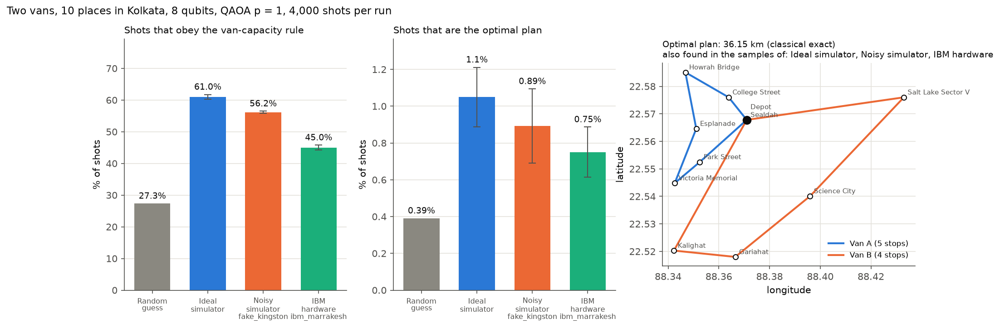

# Delivery Routing: Classical vs QAOA

**Team:** Qflux-logistics — Agrim Raj, Srijat Mukhopadhyay\
**Event:** Qiskit Fall Fest Hackathon 2026 (IISER Bhopal)\
**Problem 06:** A routing problem: deliveries on a small map

We encode delivery routing as a QUBO, solve it with QAOA on an ideal simulator, on a
noise model of an IBM chip and on a real IBM quantum computer, and compare every result
with exact classical solvers. The main experiment splits 9 real delivery stops in Kolkata
between two vans. It uses one qubit per stop (8 qubits); a classical solver then routes each
van exactly. QAOA raises the share of valid plans from 27% (random guessing) to about 61%,
and the optimal plan appears in every quantum run. On the real IBM device
**ibm_marrakesh**, 45.0% of shots were valid plans: lower than the noise model
predicted (56.2%), but still well above random guessing. **There is no quantum advantage:** a
classical heuristic finds the same optimal plan in under a millisecond. We measure where
the quantum approach breaks down: (n−1)² qubits for a full route, valid answers become
vanishingly rare, and circuit depth and noise grow quickly.



**Real-hardware run (bonus):** backend `ibm_marrakesh`, job ID `db7i1uor1c5c738kk5q0`,
2026-10-14, 4,000 shots, 3 s of quantum time, dynamical decoupling + gate twirling.
Raw counts: [`results/hardware_run.json`](results/hardware_run.json).

---

## Submission contents

| Required | Where |
|---|---|
| Code | [`src/`](src) (one folder per part, see [layout](#repository-layout)) |
| Write-up (2–4 pages) | [`WRITEUP.pdf`](WRITEUP.pdf)  |
| Main-result figure | [`figures/main_result.png`](figures/main_result.png) (+ 2 supporting figures) |
| AI-use note | [`AI_USE_NOTE.md`](AI_USE_NOTE.md)  |
| Tests | [`tests/`](tests): 27 checks against exact or classical references |
| Pinned packages | [`requirements.txt`](requirements.txt) |
| Raw numbers | [`results/summary.json`](results/summary.json); real IBM run: [`results/hardware_run.json`](results/hardware_run.json) |

---

## Reproduce the main result (clean start)

**Python 3.13** (tested with 3.13; 3.10 or newer should work). From the repository root:

```bash
python -m venv .venv
source .venv/bin/activate              # Windows: .venv\Scripts\activate
pip install -r requirements.txt

python -m unittest discover -s tests -t . -v     # ~2 s, 27 tests
python reproduce.py --show                        # ~40 s; opens the figures when done
python writeup/build_writeup.py                   # ~2 s, rebuilds WRITEUP.pdf
```

`reproduce.py` needs **no IBM account and no internet**. It writes:

- `results/summary.json`: every number in the write-up
- `figures/main_result.png`: the main-result figure
- `figures/route_qaoa_vs_random.png` and `figures/classical_scaling.png`: supporting figures

and prints a summary table like this one (exact timings vary by machine). The IBM row is read
from the saved `results/hardware_run.json`, so it reproduces without an account:

```
Main result: two vans, 10 Kolkata places, 8 qubits, p = 1
  classical optimum            36.15 km (70 fair splits checked in 6.5 ms)
  classical sweep heuristic    36.15 km (+0.0%)
  source                        valid shots  optimal shots
  random guess                   27.3% ±0.0     0.39% ±0.00
  ideal simulator                61.0% ±0.8     1.05% ±0.16
  noisy simulator (3 runs)       56.2% ±0.2     0.89% ±0.20
  IBM ibm_marrakesh              45.0% ±0.8     0.75% ±0.14
```

### Seeds and statistics

- All randomness is seeded (`src/experiments/config.py`): maps, QAOA sampling (seed 11),
  noisy simulator (seeds 11, 12, 13), transpiler (seed 7).
- **Statistical results:** every "% of shots" value comes from 4,000 shots. Single runs show a
  binomial standard error √(p(1−p)/shots). The noisy simulator is run 3 times, and we show the
  mean ± standard deviation over those runs.
- "Ideal (exact)" values are read directly from the simulated quantum state, so they have no
  sampling error.
- The full-route experiment averages over 10 random maps (4 cities) and 3 maps (5 cities).
- Classical timings are single measurements on one machine and will differ on yours.

---

## Optional: run on real IBM quantum hardware (bonus)

Needs a free IBM Quantum account ([quantum.cloud.ibm.com](https://quantum.cloud.ibm.com)).
**Never commit your API key.** The script asks for it (typing is hidden) and never saves it:

```bash
python run_hardware.py                        # paste your key when asked; prints the job ID
python reproduce.py --show                    # adds the hardware row to the table and figure
python writeup/build_writeup.py               # puts backend, date and job ID in WRITEUP.pdf
```

Instead of pasting the key each time, you can set it once per terminal with
`export QISKIT_IBM_TOKEN="your-key"` (Windows cmd: `set QISKIT_IBM_TOKEN=your-key`).

- `run_hardware.py` sends only the final tuned circuit (8 qubits, ~90 two-qubit gates,
  4,000 shots) with dynamical decoupling and gate twirling switched on. That takes a few
  seconds of quantum time, plus queue time.
- It saves the backend name, date, job ID and every measured bitstring to
  `results/hardware_run.json`, so the comparison can be re-checked without re-running the job.
- `python run_hardware.py --job-id <ID>` re-downloads a job you already ran.
- `python run_hardware.py --backend fake_kingston` is an offline rehearsal. It saves to
  `results/hardware_rehearsal.json` and is never presented as hardware.

Without a token, everything else (tests, `reproduce.py`, dashboard) works on simulators only.

---

## Repository layout

```
.
├── src/
│   ├── classical/              # classical solvers, no quantum anywhere
│   │   ├── solvers.py          #   heuristic (NN + 2-opt), Held–Karp, brute force
│   │   └── benchmark.py        #   JSON/CSV benchmarks
│   ├── quantum_simulation/     # quantum algorithm on a normal computer
│   │   ├── qubo.py             #   full route -> QUBO, (n−1)² qubits
│   │   ├── vehicle_split.py    #   two vans   -> QUBO, 1 qubit per stop
│   │   └── simulator.py        #   our own state-vector QAOA simulator + angle tuning
│   ├── quantum_hardware/       # IBM Quantum (Qiskit)
│   │   ├── circuits.py         #   QUBO + angles -> Qiskit circuit, compiled for a chip
│   │   ├── experiment.py       #   one experiment: map, encoding, classical baseline, scoring
│   │   ├── ibm_runner.py       #   noisy simulation, submit/poll jobs (dashboard)
│   │   └── run_job.py          #   hardware run for the main result (run_hardware.py)
│   ├── shared/                 # used by all of the above
│   │   ├── mapgen.py           #   made-up maps (same seed = same map)
│   │   ├── realmap.py          #   real places: great-circle / road distances, place search
│   │   ├── instance.py         #   one "map" object for every solver
│   │   └── scaling.py          #   measured + projected cost of each approach
│   ├── experiments/            # the main result: config (seeds), experiments, figures
│   └── dashboard/              # optional local web UI (python app.py)
├── tests/                      # unit tests against exact / classical references
├── figures/                    # figures used in the write-up (made by reproduce.py)
├── results/                    # summary.json (+ hardware_run.json)
├── writeup/                    # build_writeup.py + team.json
├── docs/                       # dashboard screenshots
├── reproduce.py                # main result
├── run_hardware.py             # optional real-hardware run
├── app.py  cli.py              # dashboard / command line
├── WRITEUP.pdf  AI_USE_NOTE.md  requirements.txt  LICENSE
```

---

## How it works (short version)

| Part | Idea |
|---|---|
| **Classical** | *Heuristic:* greedy nearest neighbour, then 2-opt (uncross edges); fast, no guarantee. *Held–Karp:* exact dynamic programming, O(n²·2ⁿ), practical to ~20 cities. *Brute force:* tries all (n−1)!/2 routes, practical to ~12. |
| **Full-route QUBO** | `x[i,t] = 1` means stop *i* is visited at step *t*. Energy = route length + penalty × (rule violations)². Lowest energy = optimal tour. Needs (n−1)² qubits. |
| **Two-van QUBO** | `x_i = 1` means van B serves stop *i*. Energy = −(Clarke–Wright savings of stops sharing a van) + penalty × (van B must take ⌊k/2⌋ stops)². Then each van is routed exactly. |
| **QAOA** | Start in an equal superposition. Apply *p* layers of cost `exp(−iγE)` (RZZ/RZ gates) and mixer `exp(−iβX)` (RX gates). Tune γ, β on our simulator, then measure. |
| **Hardware** | QUBO → Ising (x = (1−z)/2) → circuit, compiled for the chip's wiring (adds SWAPs). Run through Qiskit Runtime `SamplerV2` with error suppression. |

The write-up covers results and **honest limits** in detail. In short: classical methods
match or beat QAOA everywhere here, Held–Karp is exact so nothing can do better than it on
quality, and the full-route encoding becomes impractical beyond about 4–5 cities.

---

## Dashboard (optional)

```bash
python app.py        # opens http://127.0.0.1:8000
```


- **Solve:** pick a made-up map (seeded) or a **real map** (Kolkata example, click to add
  stops, or search). Real maps can use road distances from OpenStreetMap (OSRM); this needs
  internet and falls back to straight lines with a visible warning.
- **QAOA details:** see what the circuit did and how it was tuned.
- **IBM hardware panel:** ideal vs noisy vs real device. Paste your own key; it is kept in
  memory only and never saved.
- **Measured scaling** and **"where each approach breaks down"** tables.

The command line works too:

```bash
python cli.py solve --example kolkata --method both
python cli.py solve --cities 4 --method qaoa
```

---

## Troubleshooting

- **`ModuleNotFoundError`:** run commands from the repository root (`python reproduce.py`, not
  `python src/...`).
- **macOS + Python 3.13 + `pip install -e .`:** hidden `.pth` files are skipped. Not needed
  here; just use the commands above.
- **Real map has no streets / search fails:** the map tiles, search and road distances need
  internet.
- **Hardware job stays QUEUED:** real devices are shared. Wait, or check the job at
  quantum.cloud.ibm.com.

---

## Credits and sources

- [Qiskit](https://github.com/Qiskit/qiskit), [Qiskit Aer](https://github.com/Qiskit/qiskit-aer)
  and [qiskit-ibm-runtime](https://github.com/Qiskit/qiskit-ibm-runtime): circuits, noise
  model and hardware access. The QAOA approach follows IBM's
  [QAOA tutorial](https://quantum.cloud.ibm.com/docs/tutorials/quantum-approximate-optimization-algorithm);
  the QUBO encodings, simulator, solvers and experiments are our own code.
- Map data © [OpenStreetMap](https://www.openstreetmap.org/copyright) contributors; road
  distances from [OSRM](https://project-osrm.org/); place search from Nominatim; map display
  with [Leaflet](https://leafletjs.com/) (BSD-2, bundled in `src/dashboard/web/vendor`).
- Held–Karp (1962) dynamic programming; Clarke & Wright (1964) savings; 2-opt (Croes, 1958).
- AI assistance: see [AI_USE_NOTE.md](AI_USE_NOTE.md).

## License

MIT. See [LICENSE](LICENSE).
